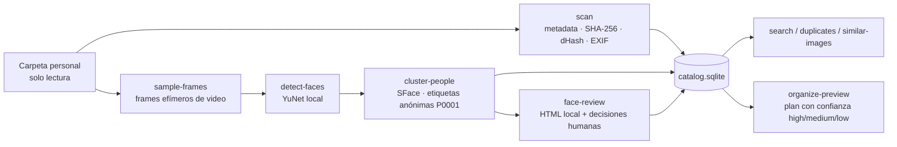

# local-file-organizer

> A 100% local, read-only Python CLI that catalogs personal photos and videos: exact duplicates, visually similar images, EXIF metadata, anonymous face clustering and a confidence-scored folder plan. It never moves or uploads a file.

**Estado:** MVP funcional (desarrollo pausado en V3.2)

## Qué problema resuelve

Tengo años de fotos y videos mezclados en carpetas, con duplicados, copias recomprimidas de WhatsApp y nombres sin sentido. Las herramientas que lo ordenan suelen subir todo a la nube o mover archivos sin preguntar. Este proyecto analiza la carpeta **sin tocar nada**. Construye un catálogo consultable y propone una organización que un humano revisa antes de aplicarla.

## Cómo funciona



Decisiones de diseño clave:

- **Read-only verificable.** Un test (`test_safety_gate.py`) prohíbe en el código cualquier llamada para mover, borrar o renombrar archivos. Además, `scan --verify-readonly` compara snapshots de la carpeta antes y después del escaneo.
- **Los embeddings faciales nunca se guardan.** Son el dato más parecido a un identificador biométrico. Se recalculan en memoria en cada ejecución y solo se persiste "persona anónima X aparece en el archivo Y".
- **Las personas se agrupan pero no se identifican.** Los clusters son anónimos (`P0001`). Solo un humano puede ponerles nombre, unirlos o separarlos con los comandos `person-*`.
- **Confianza sin probabilidades inventadas.** `organize-preview` clasifica como `high`/`medium`/`low` y manda la evidencia débil a `Revisión/` en lugar de adivinar.
- **Duplicados de forma eficiente.** Solo calcula SHA-256 cuando hay archivos del mismo tamaño. "Duplicado exacto" (mismo hash) y "visualmente similar" (dHash) se manejan como conceptos separados.

## Qué funciona hoy

Requisitos: Python 3.9+. Opcionalmente `ffmpeg`/`ffprobe` (video) y `exiftool` (EXIF); sin ellos el escaneo continúa y deja esos campos vacíos.

```bash
pip install -e .
python -m local_file_organizer scan /ruta/a/analizar
python -m local_file_organizer summary
python -m local_file_organizer duplicates
python -m local_file_organizer similar-images
python -m local_file_organizer detect-faces /ruta/a/analizar
python -m local_file_organizer cluster-people /ruta/a/analizar
python -m local_file_organizer face-review /ruta/a/analizar
python -m local_file_organizer organize-preview
python -m local_file_organizer search --category image
```

- **Tests:** `pip install -e ".[dev]" && python -m pytest -q` → **273 pasan, 16 omitidos** (Linux/WSL).
- Probé los comandos de arriba, además de `scan --full`, `sample-frames` y `persons`, sobre una carpeta de prueba. Todos terminaron sin error y detectaron bien el duplicado y las imágenes similares.
- Todo lo que el programa genera queda en `data/` y `reports/`, que están ignorados por git porque contienen rutas reales.
- La documentación técnica completa de cada versión (algoritmos, umbrales, esquema SQLite, privacidad) está en [`docs/MANUAL.md`](docs/MANUAL.md).

## Qué no funciona / quedó pendiente

- **Sin evidencia de uso sobre una biblioteca real.** Está probado con tests y carpetas de prueba, pero no conservo un catálogo generado sobre mis fotos. No puedo afirmar qué tan buenas son las agrupaciones de caras ni el plan de organización con datos reales.
- **No organiza nada todavía:** `organize-apply` (mover archivos con dry-run y rollback) nunca se implementó. Solo existe la vista previa.
- No hay OCR ni clasificación de documentos, ni búsqueda full-text.
- EXIF usa un subproceso por archivo (~0.2–0.5 s). Con decenas de miles de archivos haría falta el modo batch de exiftool.
- El dHash no resiste rotaciones grandes, espejados ni recortes agresivos.
- No verifiqué en esta revisión `face-review-import` ni los comandos `person-merge/rename/assign/unassign/split` (necesitan caras reales), ni la metadata de video/EXIF (el entorno no tenía `ffprobe`/`exiftool`).
- Hay versiones inconsistentes: `--help` dice V3.2, `pyproject.toml` dice 0.1.0 y el manual se titula V2.5.1.
- El desarrollo se pausó en un checkpoint (`wip: freeze`), después de V3.2.

## Qué aprendí

- Diseñar **privacidad por defecto** es más fácil desde el día uno: decidir qué nunca se guarda (embeddings, rutas fuera de `data/`) simplificó todo lo demás.
- Separar "detectar", "agrupar" e "identificar" en pasos distintos, con revisión humana en medio, evita que un error del modelo se convierta en una acción irreversible.
- Una garantía de seguridad vale más si está **en un test** (prohibir llamadas de escritura) que solo en la documentación.
- Iterar en versiones pequeñas (V2.1 → V3.2), cada una con tests, permitió avanzar rápido sin romper lo anterior.

## Stack

Python · SQLite · Pillow (dHash) · OpenCV (YuNet + SFace, ONNX) · ffmpeg/ffprobe · ExifTool · pytest

## Licencia

© 2026 Jhon Villegas — código bajo [MIT](LICENSE).

Los modelos en `models/` son de OpenCV Zoo y conservan su licencia (MIT y Apache-2.0); ver [`models/README.md`](models/README.md).
